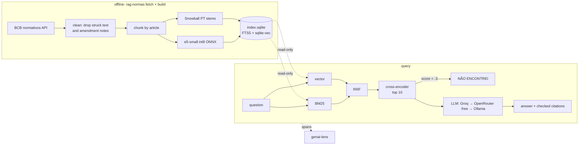

# rag-normas


Retrieval-augmented answers over the **Pix regulations of the Banco Central do Brasil**, built only from
open-source parts, with every claim cited to the act and article, and an evaluation suite that runs in CI.

> 🇧🇷 RAG sobre a regulamentação do Pix (Regulamento do Pix, Pix Automático, limites, tarifas, MED,
> DICT, penalidades). Toda resposta cita o ato e o artigo, e o sistema responde "NÃO ENCONTREI"
> quando as normas não cobrem a pergunta.

```console
$ rag-normas ask "Até que horas posso cancelar um Pix agendado?"
Para Pix Agendado, você pode solicitar o cancelamento até às 23 horas e 59 minutos do dia
imediatamente anterior ao dia para liquidação [1]. ...
  [1] IN BCB 513/2024, art. 14 → https://www.bcb.gov.br/estabilidadefinanceira/exibenormativo?tipo=...
```

## Why

Generic chatbots answer questions about Pix rules from memory: limits that changed in 2024, the
"MED" refund flow, what a bank may charge. This project answers only from the official text in
force, says where each sentence comes from, and measures how often it gets that right.

- **Only the text in force.** The BCB serves consolidated acts with every past wording struck
  through (`<s>`). The ingester drops it, so the index holds the current text only (the Pix
  regulation goes from 56k to 29k words).
- **Article-level chunks.** Chunks follow the legal structure (part → chapter → section → article),
  so a citation is `Res. BCB 1/2020 (Regulamento), art. 39-B`, not "chunk 412".
- **Hybrid search in one SQLite file.** BM25 (FTS5, Portuguese Snowball stemming) plus vectors
  (sqlite-vec), fused with reciprocal rank fusion, then an optional cross-encoder re-ranker.
  The index is built offline and opened read-only; no database service to run.
- **CPU only, no torch.** `multilingual-e5-small` and an mMiniLM cross-encoder in int8 ONNX, with a
  5 MB SentencePiece tokenizer instead of the 370 MB-of-RAM `tokenizer.json`.
- **Citations are checked.** The answer must cite `[n]` for each claim. Citations to sources that
  were not retrieved are flagged, and when the re-ranker says nothing retrieved is relevant, the
  answer is "NÃO ENCONTREI" without spending an LLM call.
- **Free LLMs only.** Groq → OpenRouter `:free` → local Ollama, with fallback on 429/5xx/timeouts.
  The server refuses an OpenRouter model that isn't `:free`.
- **Traced.** Each answer is a trace in [genai-lens](https://github.com/vicgamelo/genai-lens)
  (`rag.answer` → `rag.retrieve` + `llm.chat`), and a W3C `traceparent` from the caller makes it
  part of the agent's trace.

## Architecture



## Corpus

14 acts in force, downloaded from the BCB's public normativos API and committed cleaned in
[`data/corpus/`](data/corpus), so the index rebuilds without the network:

| Act | What |
| --- | --- |
| Res. BCB 1/2020 | Institutes Pix and approves its Regulamento (consolidated, version 43) |
| Res. BCB 19/2020 | Fees customers can be charged |
| Res. BCB 338/2023 | Public bodies' access to the DICT (Pix keys directory) |
| Res. BCB 507/2025 | Manual de Penalidades do Pix |
| IN BCB 32, 198, 199, 313, 412, 491, 511, 512, 513, 667 | Reporting, cash withdrawal (Pix Saque/Troco), device registration, onboarding, value limits, Pix Automático/Agendado, security incidents, R$15k limit waiver |

649 chunks, 124k words. Laws, decrees, regulations and other official acts are not protected by
copyright in Brazil (Lei 9.610/98, art. 8º, IV), and the BCB allows reproduction with attribution;
every chunk keeps the link to the official page. The manuals that are separate PDFs (Manual de Tempos,
Manual Operacional do DICT) are not in the corpus yet.

## Evaluation

[`eval/questions.jsonl`](eval/questions.jsonl): 82 questions. 70 come from articles sampled at random,
stratified by act ([`scripts/sample_articles.py`](scripts/sample_articles.py), seed 7); each question
was written by hand in other words, the way someone would ask, with the article(s) that answer it and a
reference answer. 12 are out of scope on purpose (Selic, TED limits, income tax, LGPD...) to measure
abstention.

### Retrieval

Relevance is at article level. `rag-normas eval retrieval` on a laptop CPU (Apple M-series, 1 thread):

| Mode | Recall@1 | Recall@5 | MRR@10 | nDCG@10 | p50 |
| --- | --- | --- | --- | --- | --- |
| BM25 (FTS5 + stemming) | 0.571 | 0.900 | 0.703 | 0.754 | 0.5 ms |
| Vector (e5-small int8) | 0.543 | 0.764 | 0.660 | 0.705 | 4 ms |
| Hybrid (RRF) | 0.600 | 0.843 | 0.719 | 0.762 | 5 ms |
| **Hybrid + re-ranker** | **0.800** | **0.900** | **0.845** | **0.857** | 315 ms |

- The re-ranker is what moves the first result: Recall@1 goes from 0.60 to 0.80.
- int8 vs fp32 embeddings: the same within 0.03 on every metric (fp32 hybrid MRR 0.747 vs 0.719), at a
  quarter of the size. See [`eval/results/retrieval.json`](eval/results/retrieval.json).
- BM25 alone is strong here, partly because questions were written from the article text, even if
  reworded. Read the numbers as a regression baseline, not a benchmark.
- The re-ranker settings (top 10, 256 tokens) and the abstention threshold were picked on this same
  set; there is no separate dev split with 82 questions.

CI fails if Recall@5 or MRR@10 of any mode drops more than 0.03 below [`eval/baseline.json`](eval/baseline.json),
and posts the comparison with the committed results (`rag-normas eval compare`) as the job summary.

### Answers

`rag-normas eval answers`: re-rank mode, top 5 passages to the LLM, then an LLM judge splits each answer
into claims and checks every claim against the passages it cites, and the answer against the reference.
Both models ran locally with Ollama: `qwen3.5:9b` answering, `gemma4:12b` judging.

| Metric | Value |
| --- | --- |
| Answerable questions answered | 66/70 (94%) |
| Out-of-scope questions answered "NÃO ENCONTREI" | 12/12 |
| Answers with at least one citation | 100% |
| Answers citing the expected article | 95% |
| Citations to sources that weren't retrieved | 0 |
| Faithfulness (claims supported by the cited passage) | 0.99 |
| Correct per judge (yes / partial) | 65 / 1 of 66 |
| LLM latency p50 | 14 s (local, M-series) |

- The 4 misses are abstentions, not wrong answers: the expected article wasn't in the 5 passages sent,
  and the model said so instead of guessing. Retrieval is where those fail, not the LLM.
- The judge is a 12B model and lenient; read faithfulness and correctness as "no obvious hallucination",
  not as proof. The per-question rows are in [`eval/results/`](eval/results) for checking by hand.
- The full run used a -1.0 abstention threshold; the 16 questions it affects were re-run at the current
  -3.0 default with the same outcome ([`answers-…-gate-3.json`](eval/results/answers-ollama-qwen3.5-9b-gate-3.json)).
  At -3.0, 6 of the 12 out-of-scope questions stop at the threshold and the LLM declines the other 6.
- Not evaluated yet with the default provider (Groq `openai/gpt-oss-20b`): no key on the machine that ran it.

## Quickstart

```bash
uv sync
uv run rag-normas models          # pinned ONNX models, checked by sha256 (~240 MB)
uv run rag-normas build           # chunk + embed + index -> data/index-e5-small-int8.sqlite
uv run rag-normas search "devolução de Pix por fraude"

export GROQ_API_KEY=...           # or OPENROUTER_API_KEY, or RAG_LLM_PROVIDERS=ollama
uv run rag-normas ask "O banco pode cobrar tarifa de pessoa física para enviar Pix?"
uv run rag-normas serve           # MCP at /mcp, JSON at /api/search and /api/ask
```

### As an MCP server

```bash
claude mcp add --transport http normas-pix http://localhost:8000/mcp
```

| Tool | |
| --- | --- |
| `buscar_normas(pergunta, k=5)` | Passages with act, article, link and score. No LLM: cheap, the agent reads and cites them |
| `perguntar_normas_pix(pergunta, traceparent?)` | A short answer with checked citations, or "NÃO ENCONTREI" |

### HTTP

```bash
curl -s localhost:8000/api/ask -H 'content-type: application/json' \
  -H 'traceparent: 00-4bf92f3577b34da6a3ce929d0e0e4736-00f067aa0ba902b7-01' \
  -d '{"question": "Até que horas posso cancelar um Pix agendado?"}'
```

## Running it in a container

The image builds the index from the committed corpus, runs as uid 10001 and works with `--read-only`.
Measured with `docker run --memory 512m --cpus 0.5 --read-only --cap-drop ALL`, `/api/search` in a loop:

| Mode | RAM idle | RAM peak under load | Throughput at 0.5 CPU | p50 (1 client) |
| --- | --- | --- | --- | --- |
| `RAG_MODE=rerank` (default) | 359 MiB | 404 MiB | ~1 req/s | 1.0 s |
| `RAG_MODE=hybrid` (no re-ranker) | 242 MiB | 261 MiB | ~74 req/s | 7 ms |

`/api/ask` adds one LLM call on top; that time is the provider's, not this container's CPU.

| Variable | Default | |
| --- | --- | --- |
| `GROQ_API_KEY`, `OPENROUTER_API_KEY` | — | Free-tier keys; a provider without a key is skipped |
| `RAG_LLM_PROVIDERS` | `groq,openrouter` | Fallback order; add `ollama` for a local model |
| `RAG_GROQ_MODEL` / `RAG_OPENROUTER_MODEL` / `RAG_OLLAMA_MODEL` | `openai/gpt-oss-20b` / `google/gemma-4-26b-a4b-it:free` / `qwen3.5:9b` | |
| `RAG_MODE` | `rerank` | `bm25`, `vector`, `hybrid` or `rerank` |
| `RAG_MIN_RERANK_SCORE` | `-3.0` | Below it, "NÃO ENCONTREI" without calling the LLM |
| `RAG_MAX_CONCURRENCY` | `1` | Requests doing CPU work at once; the rest wait |
| `GENAI_LENS_ENDPOINT`, `GENAI_LENS_API_KEY` | — | Traces on when set |
| `MCP_ALLOWED_HOSTS` | — | Host header allowlist (DNS rebinding protection) |

It has no rate limit or auth of its own: keep it on an internal network, behind something that has.

## Development

```bash
uv sync
uv run pytest -m "not models"     # no model files needed: fake embedder, mocked LLM
uv run rag-normas models --all && uv run pytest   # + tokenizer equivalence and the retrieval gate
uv run ruff check . && uv run mypy
uv run rag-normas eval answers --judge ollama --judge-model gemma4:12b   # LLM judge, on demand
```

```
src/rag_normas/
├── corpus.py      # BCB API -> clean text in force
├── chunking.py    # structure-aware chunks and citations
├── text.py        # Portuguese analyzer for BM25
├── models.py      # pinned ONNX models, SentencePiece tokenizer
├── index.py       # SQLite: FTS5 + sqlite-vec
├── search.py      # BM25, vector, RRF, re-rank
├── answer.py      # prompt, citation checks, abstention
├── llm.py         # Groq -> OpenRouter :free -> Ollama
├── tracing.py     # genai-lens spans, traceparent
├── evaluation.py  # retrieval and answer metrics, LLM judge
└── server.py      # MCP tools + JSON API
```

## Roadmap

- [ ] The PDF manuals that complete the regulation (Manual de Tempos, Manual Operacional do DICT)
- [ ] Track amendments: re-fetch, diff and re-index when the BCB publishes a new version
- [ ] A second domain (CNPJ alfanumérico, IN RFB 2.229/2024)
- [ ] Questions written by people other than the author

## License

MIT © Victor Gabriel Andrade de Melo
